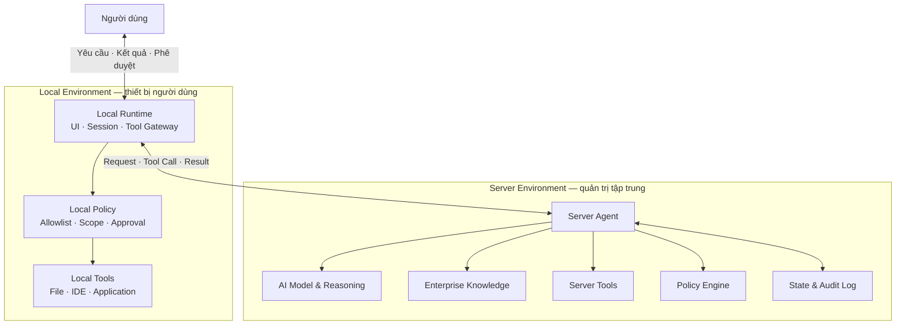
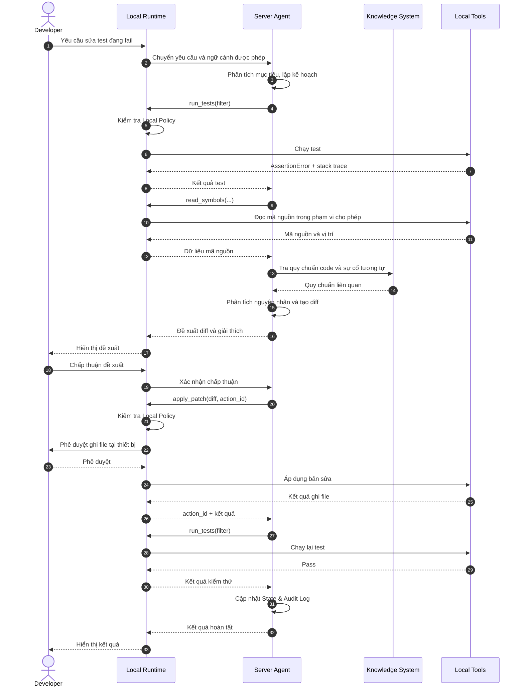

# Hybrid AI Agent Architecture: Server quyết định, Local thực thi

Làm thế nào để AI Agent trên Server sử dụng được công cụ và dữ liệu trên máy người dùng, trong khi vẫn kiểm soát được quyền truy cập, hành động và các rủi ro bảo mật?

## 1. Đặt vấn đề

AI Agent đang chuyển từ vai trò trả lời câu hỏi sang trực tiếp thực hiện công việc. Agent có thể phân tích yêu cầu, lập kế hoạch, sử dụng công cụ và đánh giá kết quả để hoàn thành mục tiêu.

Tuy nhiên, khi triển khai AI Agent vào ứng dụng thực tế, tri thức và khả năng thực thi không phải lúc nào cũng nằm trong cùng một môi trường.

### 1.1. Hai môi trường với những năng lực khác nhau

**Server** tập trung AI Model, tri thức doanh nghiệp, dữ liệu dùng chung và các dịch vụ backend. Đây là môi trường có thể quản lý tập trung, giám sát và áp dụng chính sách bảo mật.

**Local** là môi trường làm việc trực tiếp của người dùng. Nó có quyền truy cập vào tài liệu đang mở, mã nguồn, filesystem, IDE và các ứng dụng trên thiết bị.

Ví dụ, lập trình viên yêu cầu:

> Test `test_checkout_discount` trong project của tôi đang bị lỗi. Hãy tìm nguyên nhân, đối chiếu với quy chuẩn code của công ty và sửa giúp tôi.

Để xử lý yêu cầu này, Agent cần kết hợp hai nguồn năng lực:

- **Server:** Quy chuẩn code, tài liệu kiến trúc, lịch sử sự cố và khả năng phân tích.
- **Local:** Mã nguồn, môi trường chạy test, Git và các công cụ phát triển.

Nếu chỉ hoạt động trên Server, Agent không thể trực tiếp kiểm tra môi trường phát triển. Nếu chỉ hoạt động trên Local, Agent có thể thiếu tri thức doanh nghiệp và khả năng quản trị tập trung.

### 1.2. Vấn đề khi Server và Local cùng ra quyết định

Một cách tiếp cận là triển khai hai Agent độc lập: một Agent trên Server và một Agent trên máy người dùng. Hai Agent trao đổi thông tin và phối hợp thực hiện nhiệm vụ.

Tuy nhiên, mô hình này làm tăng độ phức tạp trong kiểm soát hành động. Máy người dùng có thể chứa nội dung không đáng tin cậy, chẳng hạn tài liệu bên thứ ba, mã nguồn hoặc trang web. Những nội dung này có thể chứa chỉ thị độc hại nhằm điều khiển Agent thông qua *prompt injection*.

Nếu Local Agent có quyền tự lập kế hoạch và thực thi, hệ thống phải giải quyết những câu hỏi:

- Agent nào chịu trách nhiệm về quyết định cuối cùng?
- Làm thế nào để hai Agent không thực hiện những hành động mâu thuẫn?
- Chính sách bảo mật được áp dụng thống nhất như thế nào?
- Làm thế nào để kiểm toán toàn bộ chuỗi quyết định?
- Điều gì xảy ra khi hai Agent mất kết nối?

Simon Willison mô tả rủi ro *lethal trifecta*: một Agent đồng thời tiếp cận dữ liệu riêng tư, nội dung không tin cậy và công cụ có khả năng gửi dữ liệu ra ngoài. Khi ba điều kiện này cùng tồn tại, prompt injection có thể dẫn đến rò rỉ dữ liệu.

Bài toán kiến trúc cần giải quyết là **kết hợp năng lực của Server và Local mà không phân tán quyền quyết định một cách không cần thiết**.

## 2. Giải pháp: Server quyết định, Local thực thi

### 2.1. Nguyên tắc kiến trúc

Mô hình đề xuất phân chia trách nhiệm thành hai thành phần:

**Server Agent — suy luận và điều phối:** Phân tích yêu cầu, lập kế hoạch, truy xuất tri thức, lựa chọn công cụ, quyết định hành động tiếp theo và đánh giá kết quả.

**Local Runtime — tiếp nhận yêu cầu và thực thi:** Cung cấp giao diện tương tác với người dùng, chuyển yêu cầu lên Server Agent, công bố công cụ trên thiết bị, kiểm tra quyền, thực thi lệnh được phép và trả kết quả. Local Runtime không tự lập kế hoạch hoặc khởi xướng hành động ngoài yêu cầu đã được cấp quyền.

Trong phạm vi kiến trúc này, Server Agent là thành phần duy nhất chịu trách nhiệm lập kế hoạch và ra quyết định nghiệp vụ. Local Runtime vẫn có quyền từ chối một hành động, kể cả khi Server đã cho phép.

### 2.2. Mô hình tổng thể

**Luồng giao tiếp chính: Người dùng → Local Runtime → Server Agent.** Người dùng không gọi trực tiếp Server Agent. Local Runtime đóng vai trò điểm tiếp nhận yêu cầu và cầu nối thực thi công cụ.

Mỗi lệnh gọi công cụ từ Server phải đi qua hai lớp kiểm soát:

- **Policy Engine trên Server:** Xác định Agent được phép gọi công cụ nào, với tham số nào và trong ngữ cảnh nào.
- **Local Policy trên thiết bị:** Kiểm tra lại công cụ, phạm vi truy cập và yêu cầu phê duyệt. Lệnh hợp lệ trên Server không mặc nhiên được thực thi tại Local.

### 2.3. Các cơ chế chính

#### Cơ chế 1. Tool Contract

Local Runtime công bố các công cụ thông qua hợp đồng rõ ràng. Mỗi công cụ xác định tên, tham số đầu vào, cấu trúc kết quả và mức độ rủi ro.

| Công cụ | Chức năng | Mức rủi ro |
|---|---|---|
| `read_file` | Đọc nội dung tệp | Chỉ đọc |
| `run_tests` | Chạy bộ kiểm thử | Có thể có tác dụng phụ |
| `apply_patch` | Thay đổi mã nguồn | Ghi dữ liệu |
| `execute_command` | Chạy lệnh hệ thống | Nhạy cảm |

Server Agent chỉ được gọi công cụ đã được công bố và cho phép. Có thể sử dụng **Model Context Protocol (MCP)** để mô tả và kết nối các công cụ. Tuy nhiên, MCP không tự bảo đảm chính sách truy cập. Hệ thống triển khai vẫn phải kiểm tra quyền ở cả Server và Local.

#### Cơ chế 2. Composite Tools

Một hạn chế của kiến trúc Hybrid Agent là độ trễ khi Server liên tục gọi công cụ trên Local. Thay vì thực hiện nhiều lệnh nhỏ, Local Runtime có thể cung cấp **Composite Tools**: những công cụ kết hợp nhiều thao tác xác định trong một lần gọi.

- `extract_sections(doc, keywords)`: Trích xuất các đoạn tài liệu phù hợp.
- `get_document_outline(doc)`: Đọc cấu trúc tài liệu.
- `apply_patch(doc, changes)`: Áp dụng một tập thay đổi.

Composite Tools giảm số lượt trao đổi giữa Server và Local. Các công cụ này thực hiện quy trình đã định nghĩa, không sử dụng AI Model để tự quyết định mục tiêu hoặc lựa chọn hành động mới.

#### Cơ chế 3. Kiểm soát dữ liệu không tin cậy

Dữ liệu do Local Runtime trả về có thể chứa nội dung độc hại. Ví dụ, tệp mã nguồn có thể chứa chỉ thị yêu cầu AI tải và chạy script bên ngoài.

Server Agent phải phân biệt giữa dữ liệu cần phân tích và chỉ thị được phép thực hiện. Để giảm rủi ro prompt injection, hệ thống cần kết hợp:

- Xác định nguồn và mức độ tin cậy của dữ liệu.
- Giới hạn công cụ Agent có thể sử dụng.
- Kiểm tra quyền trước mỗi hành động.
- Yêu cầu phê duyệt đối với hành động nhạy cảm.

Việc yêu cầu model bỏ qua chỉ thị độc hại không đủ để bảo đảm an toàn. Các ràng buộc phải được thực thi bằng cơ chế độc lập với model.

#### Cơ chế 4. Tối thiểu hóa dữ liệu

Trong mô hình suy luận tập trung, Server cần nhận dữ liệu từ Local để xử lý yêu cầu. Điều này tạo ra rủi ro về quyền riêng tư và bảo mật dữ liệu.

Hệ thống nên giới hạn dữ liệu truyền lên Server theo nhu cầu từng bước. Local Runtime có thể lọc hoặc che thông tin nhạy cảm trước khi trả kết quả. Người dùng cần có khả năng kiểm tra phạm vi dữ liệu được chia sẻ.

#### Cơ chế 5. Quản lý trạng thái và Idempotency

Server lưu trạng thái nhiệm vụ và lịch sử quyết định, đóng vai trò nguồn trạng thái điều phối chính.

Mỗi hành động có tác dụng phụ cần gắn `action_id` duy nhất. Local Runtime ghi nhận kết quả để tránh thực thi trùng lặp khi Server gửi lại yêu cầu.

Khi mất kết nối, Local Runtime không tự khởi tạo bước xử lý tiếp theo. Khi kết nối khôi phục, Server đối chiếu trạng thái trước khi tiếp tục. Đối với thao tác đang thực hiện dở, hệ thống phải xác định kết quả thực tế trước khi thử lại.

#### Cơ chế 6. Bảo mật nhiều lớp

| Lớp kiểm soát | Trách nhiệm |
|---|---|
| Server Policy Engine | Kiểm tra quyền gọi công cụ và ngữ cảnh thực thi |
| Local Policy | Giới hạn công cụ, tài nguyên và phạm vi truy cập |
| User Approval | Phê duyệt thao tác nhạy cảm |
| Audit Log | Ghi nhận quyết định, hành động và kết quả |

Các lớp kiểm soát phải hoạt động độc lập. Nếu Server Agent đưa ra lệnh không an toàn, Local Policy vẫn có thể từ chối.

## 3. Thực hiện: Ví dụ sửa lỗi trong môi trường phát triển

### 3.1. Luồng xử lý

Lập trình viên yêu cầu:

> Test `test_checkout_discount` đang fail. Hãy tìm nguyên nhân, đối chiếu với quy chuẩn code của công ty và sửa giúp tôi.

Quy trình gồm sáu bước:

1. **Tiếp nhận yêu cầu:** Local Runtime nhận yêu cầu từ người dùng và chuyển đến Server Agent.
2. **Thu thập thông tin:** Server gọi `run_tests` và công cụ đọc mã nguồn thông qua Local Runtime.
3. **Phân tích:** Server kết hợp kết quả kiểm thử, mã nguồn và quy chuẩn doanh nghiệp để xác định nguyên nhân.
4. **Đề xuất thay đổi:** Server tạo diff, giải thích và yêu cầu người dùng chấp thuận.
5. **Thực thi có kiểm soát:** Server gọi `apply_patch`; Local Policy kiểm tra phạm vi và yêu cầu phê duyệt tại thiết bị trước khi ghi.
6. **Kiểm tra và hoàn tất:** Server yêu cầu chạy lại test, đánh giá kết quả và cập nhật trạng thái.

Toàn bộ suy luận diễn ra trên Server. Local Runtime tiếp nhận yêu cầu, kiểm soát công cụ và trả kết quả. Nếu mã nguồn chứa prompt injection, nội dung đó vẫn phải được xử lý như dữ liệu chưa tin cậy.

### 3.2. Phạm vi thực thi tại Local

| Mức độ | Cách hoạt động | Định hướng |
|---|---|---|
| Tool Execution | Server gọi công cụ riêng lẻ | Sử dụng mặc định |
| Composite Tools | Local thực hiện chuỗi thao tác xác định | Tối ưu hiệu năng |
| Local Delegation | Local dùng model riêng để lập kế hoạch con | Ngoài phạm vi thiết kế hiện tại |

Local Delegation có thể được nghiên cứu khi có yêu cầu xử lý dữ liệu hoàn toàn trên thiết bị. Tuy nhiên, cách tiếp cận này làm thay đổi ranh giới trách nhiệm và cần mô hình bảo mật riêng.

### 3.3. Đánh đổi kiến trúc

| Lợi ích | Đánh đổi |
|---|---|
| Một nơi điều phối và ra quyết định | Tăng độ trễ khi gọi công cụ |
| Chính sách và model được quản lý tập trung | Phụ thuộc kết nối mạng |
| Có thể kiểm toán chuỗi hành động | Cần thiết kế quản lý trạng thái |
| Local Runtime đơn giản hơn Agent độc lập | Cần đầu tư thiết kế Tool Contract |
| Kiểm soát quyền tại cả Server và Local | Dữ liệu có thể phải truyền lên Server |

Hai vấn đề cần ưu tiên là độ trễ và bảo mật dữ liệu. Composite Tools giảm số lượt trao đổi. Cơ chế tối thiểu hóa dữ liệu giảm lượng thông tin truyền lên Server. Cả hai giải pháp cần được đánh giá bằng số liệu thực tế.

### 3.4. Hướng triển khai

1. Xây dựng Local Runtime với giao diện tiếp nhận yêu cầu, các công cụ chỉ đọc và Local Policy cơ bản.
2. Tích hợp Server Agent, Policy Engine và Audit Log.
3. Bổ sung công cụ ghi dữ liệu, cơ chế phê duyệt và `action_id`.
4. Tối ưu các chuỗi thao tác phổ biến bằng Composite Tools.
5. Mở rộng hỗ trợ nhiều thiết bị và nhiều nhóm công cụ.

Trong giai đoạn đầu, ưu tiên kiểm chứng luồng điều phối, giới hạn quyền và khả năng phục hồi sau mất kết nối trước khi mở rộng số lượng công cụ.

## 4. Kết luận

Kiến trúc Hybrid AI Agent cho phép kết hợp khả năng suy luận tập trung với năng lực thực thi trên thiết bị người dùng.

Trong mô hình đề xuất, **người dùng tương tác qua Local Runtime**. Local Runtime chuyển yêu cầu đến Server Agent, cung cấp công cụ, kiểm tra quyền và thực thi hành động được phép. Server Agent chịu trách nhiệm phân tích, lập kế hoạch và điều phối. Người dùng giữ quyền phê duyệt những thao tác nhạy cảm.

Cách phân chia này giúp xác định rõ trách nhiệm của từng thành phần, kiểm toán hành động và áp dụng chính sách bảo mật nhất quán.

Kiến trúc vẫn phải giải quyết độ trễ mạng, bảo mật dữ liệu và quản lý trạng thái khi kết nối gián đoạn. Những vấn đề này cần được kiểm chứng trong quá trình triển khai.

**Giá trị cốt lõi của mô hình nằm ở việc tận dụng năng lực của cả Server và Local, trong khi duy trì ranh giới rõ ràng giữa quyết định và thực thi.**

---

## Tài liệu tham khảo

Các nguồn giữ theo tài liệu gốc; chưa thực hiện kiểm chứng độc lập về nội dung và thời điểm xuất bản.

1. Simon Willison — *The lethal trifecta for AI agents* (2025).
2. Walden Yan, Cognition — *Don't Build Multi-Agents* (2025).
3. Walden Yan, Cognition — *Multi-Agents: What's Actually Working*.
4. [Model Context Protocol Specification](https://modelcontextprotocol.io/specification).
5. Anthropic — *Writing effective tools for agents — with agents* (2025).
6. Simon Willison — *The Dual LLM pattern* (2023).
7. Simon Willison — *CaMeL offers a promising new direction for mitigating prompt injection* (2025).
8. *Design Patterns for Securing LLM Agents against Prompt Injections* (2025).
9. [OWASP LLM01:2025 — Prompt Injection](https://genai.owasp.org/llmrisk/llm01-prompt-injection/).

> **Ghi chú:** Bài viết mô tả hướng thiết kế kiến trúc. Composite Tools, chính sách bảo mật hai lớp và cơ chế phục hồi là các giải pháp đề xuất, chưa phải kết quả kiểm chứng hiệu năng hoặc bảo mật của hệ thống đã triển khai.
